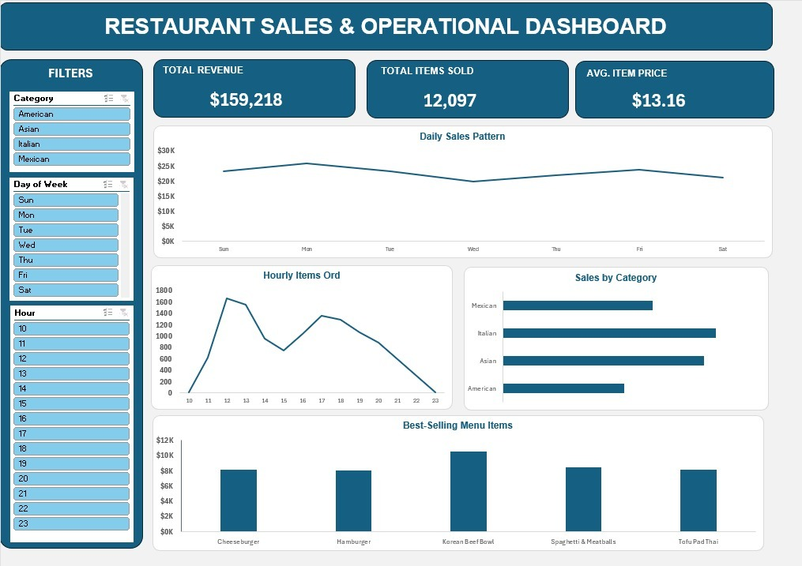

# 🍽️ Restaurant Sales & Operational Dashboard

Dashboard Excel interaktif untuk memantau penjualan, jam sibuk, dan popularitas menu restoran.

## 📌 Ringkasan

- **Tools:** Microsoft Excel (PivotTable, PivotChart, Slicer)
- **Dataset:** [Maven Analytics – Restaurant Order Details](https://www.mavenanalytics.io/data-playground)
- **Mata uang:** USD ($), sesuai dataset asli

## 📊 Metrik Utama

| KPI | Nilai |
|---|---|
| Total Revenue | $159,218 |
| Total Items Sold | 12,097 |
| Avg. Item Price | $13.16 |

> **Catatan metrik:** PivotTable dibuat pada level item pesanan, jadi KPI memakai volume item agar tetap dinamis saat slicer dipakai. Secara keseluruhan ada 5,343 order unik (rata-rata $29.80 per order, ~2,3 item per order).

## 🧩 Fitur

- **Slicer:** Category, Day of Week, Hour (terhubung ke semua chart dan KPI)
- **Chart:** Daily Sales Pattern, Hourly Items Ordered, Sales by Category, Best-Selling Menu Items

## 🔍 Insight Utama

1. **Dua jam sibuk:** 12:00-13:00 (puncak 1.600+ item per jam) dan 17:00-18:00.
2. **Kategori:** Italian dan Asian paling besar kontribusinya, American paling rendah.
3. **Hari:** Penjualan relatif stabil; Senin tertinggi, Rabu terendah.

## 💡 Rekomendasi

- Fokuskan staf pada dua jam sibuk, dan pakai jam 14:00-16:00 untuk persiapan bahan dan istirahat.
- Bundling menu American dengan bestseller Italian/Asian.
- Tawarkan add-on $2-$4 (minuman/side dish) untuk menaikkan nilai per order dari $29.80 ke ~$32-$34.
- Uji promo tengah minggu untuk hari Rabu.

## ▶️ Cara Menggunakan

1. Unduh `restaurant_sales_dashboard.xlsx` dan buka di Microsoft Excel (versi desktop).
2. Buka sheet **dashboard**, lalu klik slicer untuk memfilter. Tahan **Ctrl** untuk pilih lebih dari satu, klik ikon filter ✕ untuk reset.

## 👤 Penulis

**Iqbal Dwi Fathonah** · Data Analyst
